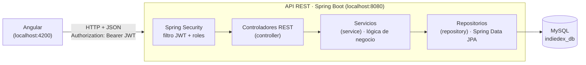
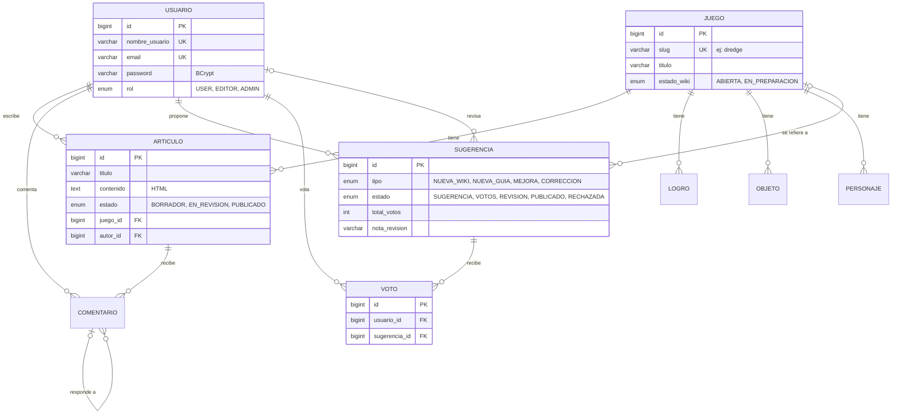
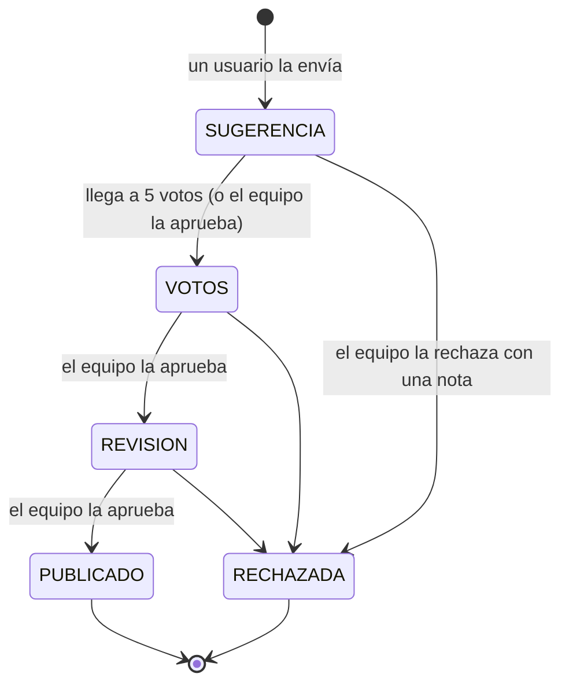

[English](README.md) | [Español](README.es.md)

# IndieDex

Una wiki multijuego dedicada a los indies, escrita toda en español. Arranca con Dredge y crece desde ahí: cualquiera puede proponer una wiki nueva o una guía nueva, y las propuestas que reúnen suficientes votos de la comunidad pasan a revisión.

Proyecto de Back-End de Zoe Gabriel Balagay Aponte, Juandiego Rosas Reyes y Cristian Alexander Vargas Fajardo.

> Sitio en vivo: pegar aquí la URL de Render cuando termine el despliegue.

## Tecnologías

El backend es Java 17+ con Spring Boot 3.5 (Web, Data JPA, Validation y Security), JWT con jjwt y Lombok para quitarse boilerplate de encima. Los datos van en MySQL 8. La API se documenta sola con Swagger/OpenAPI vía springdoc, y el frontend es Angular 21. Hay además una colección de Postman con 62 peticiones que traen sus propias pruebas.

## Arquitectura

Cliente-servidor, con el backend repartido en capas:



Una petición entra por un controlador, que valida los datos con `@Valid` y responde con DTOs. El controlador delega en un servicio, que es donde viven las reglas de verdad: el flujo de sugerencias, un voto por usuario, los permisos finos. Los servicios hablan con los repositorios, interfaces de Spring Data JPA sobre las entidades de `model`. Todo lo que entra y sale de la API pasa por un DTO, así que la contraseña nunca llega al cliente. Los errores se centralizan en `GlobalExceptionHandler` para que toda la API falle con el mismo formato.

## Modelo de datos



El script completo está en [`database/schema.sql`](database/schema.sql).

### Cómo avanza una sugerencia



Cinco votos es el umbral por defecto, no una regla fija. Se cambia en `application.properties`, en `indiedex.sugerencias.umbral-votos`.

## Cómo ejecutarlo en local

Hace falta JDK 17 o superior (lo probamos en 17, 21 y 24), Maven 3.9+ o IntelliJ IDEA con su Maven incluido, MySQL 8 (sirve el de XAMPP) y Node.js 20.19+ o 22.12+ con npm para Angular 21.

### 1. Base de datos

Enciende MySQL. En XAMPP es el botón Start al lado de MySQL. No hace falta crear nada a mano: al arrancar, Spring crea la base `indiedex_db`, las tablas y los datos de ejemplo.

Si prefieres montar el esquema desde el script, corre antes `mysql -u root -p < database/schema.sql`.

### 2. Backend

XAMPP viene sin contraseña en `root`, así que la mayoría se puede saltar este paso. Si la tuya sí tiene, copia `backend/src/main/resources/application-local.properties.example` como `application-local.properties` en la misma carpeta y escribe ahí tu contraseña. Ese archivo está en el gitignore.

Después, desde `backend/`:

```bash
mvn spring-boot:run
```

En IntelliJ: abrir la carpeta `backend`, esperar a que cargue Maven y ejecutar `IndiedexApplication`.

La API responde en <http://localhost:8080/api/juegos>, y Swagger está en <http://localhost:8080/swagger-ui.html>.

### 3. Frontend

```bash
cd frontend
npm install
npm start
```

Abrir <http://localhost:4200>. La dirección del backend vive en `frontend/src/environments/`: `environment.development.ts` para trabajar en local, `environment.ts` para la versión desplegada.

## Despliegue en Render

La aplicación se publica en [Render](https://render.com) como un solo servicio. El `Dockerfile` compila Angular, lo mete dentro de Spring Boot, y la página y la API terminan en la misma dirección. La base de datos va en TiDB Cloud (compatible con MySQL y gratis) porque Render no ofrece MySQL.

El paso a paso completo está en [DESPLIEGUE.md](DESPLIEGUE.md). En corto:

1. Crear la base gratuita en TiDB Cloud y copiar host, usuario y contraseña.
2. En Render, ir a New → Blueprint, elegir este repositorio (lee el `render.yaml`) y llenar `DB_URL`, `DB_USER` y `DB_PASSWORD`.
3. Esperar a que el servicio diga Live y abrir `https://tu-servicio.onrender.com`.

## Autenticación con JWT

`POST /api/auth/login` (o `/registro`) compara la contraseña contra su hash BCrypt y devuelve un JWT firmado con HMAC-SHA, en `security/JwtService.java`. El token lleva el usuario, el rol y una expiración a 24 horas.

Angular lo guarda y lo adjunta en cada petición como `Authorization: Bearer <token>`, cosa que hace `frontend/src/app/core/auth.interceptor.ts`. De vuelta en el backend, `security/JwtAuthFilter.java` verifica la firma y la expiración y deja al usuario autenticado; a partir de ahí, `config/SecurityConfig.java` y las anotaciones `@PreAuthorize` deciden qué puede hacer.

Sin token, con uno vencido o con uno alterado, la respuesta es 401. Con un token válido pero un rol insuficiente, 403.

Para verlo funcionando: hacer login desde Swagger, copiar el `token` de la respuesta y pegarlo en Authorize.

## Cuentas de prueba

Todas usan la contraseña `indiedex123`, y se puede entrar con el nombre de usuario o con el correo.

| Usuario | Correo | Rol | Puede |
|---|---|---|---|
| `admin` | admin@indiedex.com | ADMIN | Todo, incluido borrar juegos y cambiar roles |
| `FaroNorte` | faronorte@indiedex.com | EDITOR | Escribir artículos, revisar y publicar sugerencias |
| `MarineroLunar` | marinero@indiedex.com | EDITOR | Igual que FaroNorte |
| `LunaVerde` | lunaverde@correo.com | USER | Comentar, sugerir y votar |
| `NieblaBaja`, `SemillaAzul`, `Pescadora88` | ... | USER | Comentar, sugerir y votar |

Para ver el umbral de votos en acción, la sugerencia "Abrir la wiki de Stardew Valley" está en 4 votos. Regístrate con una cuenta nueva, vótala y pasa sola de Sugerencia a Votos.

## Gestionar contenido como EDITOR o ADMIN

Entrar con una cuenta del equipo agrega dos enlaces a la barra, Gestión y Revisión.

Gestión → Juegos y contenido (`/equipo/juegos`) lista todos los juegos, y desde ahí se crean y se editan. Borrar es solo para ADMIN, y se lleva por delante toda la wiki del juego.

Nueva guía abre un formulario con una barra para insertar bloques (introducción, subtítulo, párrafo, consejo, imagen, lista de mejoras, fuentes) y una vista previa que se actualiza mientras escribes. La guía se guarda como Borrador, En revisión o Publicado, y las dos primeras solo las ve el equipo. Al publicar la primera guía de un juego, su wiki pasa a "Wiki abierta".

Logros, objetos y personajes tienen cada uno su botón "+ Nuevo" en la pestaña correspondiente de la wiki y un enlace "Editar" en cada ficha. Las páginas de juego y de guía traen sus propios botones "Editar juego" y "Editar guía".

Revisión (`/revision`) es donde se aprueban o se rechazan las propuestas de la comunidad, con una nota de vuelta para quien la escribió.

Las imágenes se eligen de lo que haya en `frontend/public/images`, listado en `core/imagenes.ts`.

## Permisos

| Acción | Sin sesión | USER | EDITOR | ADMIN |
|---|:-:|:-:|:-:|:-:|
| Ver juegos, artículos publicados, sugerencias | sí | sí | sí | sí |
| Comentar, sugerir, votar, editar mi perfil | | sí | sí | sí |
| Borrar mis comentarios | | sí | sí | sí |
| Crear/editar juegos, artículos, logros, objetos, personajes | | | sí | sí |
| Ver borradores, panel de revisión, aprobar/rechazar | | | sí | sí |
| Borrar comentarios de otros (moderar) | | | sí | sí |
| Borrar juegos, listar usuarios, cambiar roles | | | | sí |

## Rutas de la API

Todas cuelgan de `http://localhost:8080`. La lista completa con ejemplos está en Swagger.

| Método | Ruta | Qué hace |
|---|---|---|
| POST | `/api/auth/registro` | Crear cuenta (siempre USER) y devolver token |
| POST | `/api/auth/login` | Iniciar sesión con correo o usuario |
| GET | `/api/estadisticas` | Cifras del inicio |
| GET | `/api/buscar?q=` | Buscador global |
| GET | `/api/juegos?buscar=&genero=&estado=&orden=` | Catálogo con filtros |
| GET | `/api/juegos/{slug}` | Ficha del juego |
| GET | `/api/juegos/{slug}/articulos` · `/logros` · `/objetos` · `/personajes` | Pestañas de la wiki |
| POST · PUT · DELETE | `/api/juegos` · `/api/juegos/{id}` | Gestionar juegos |
| GET | `/api/articulos/recientes` · `/api/articulos/{id}` | Artículos |
| POST · PUT · PATCH · DELETE | `/api/articulos` · `/{id}` · `/{id}/estado` | Gestionar artículos |
| GET · POST · PUT · DELETE | `/api/logros` · `/api/objetos` · `/api/personajes` | Contenido de la wiki |
| GET · POST | `/api/articulos/{id}/comentarios` | Ver y escribir comentarios (`padreId` para responder) |
| DELETE | `/api/comentarios/{id}` | Borrar comentario |
| GET · POST | `/api/sugerencias` | Listar (filtros, orden, búsqueda) y proponer |
| POST · DELETE | `/api/sugerencias/{id}/voto` | Votar y retirar el voto |
| PATCH | `/api/sugerencias/{id}/avanzar` · `/rechazar` | Aprobar, o rechazar con una nota |
| GET | `/api/sugerencias/resumen` | Cifras del panel de revisión |
| GET · PUT | `/api/usuarios/me` | Mi perfil |
| GET | `/api/usuarios/me/sugerencias` · `/votos` · `/comentarios` | Mi actividad |
| GET · PATCH | `/api/usuarios` · `/api/usuarios/{id}/rol` | Administración de usuarios |

Los errores siempre vuelven con el mismo formato:

```json
{ "estado": 400, "error": "Bad Request", "mensaje": "Hay datos que corregir",
  "ruta": "/api/auth/registro", "fecha": "2026-10-20T15:30:00",
  "campos": { "email": "El correo no es válido" } }
```

## Pruebas con Postman

Importar `backend/postman/IndieDex.postman_collection.json`, arrancar el backend con la base recién creada y darle a Run collection dejando que corra en orden. Cada petición guarda lo que necesitan las siguientes (tokens, ids) y verifica la respuesta: permisos por rol (401/403), validaciones (400), duplicados (409) y todo el flujo de sugerencias y votos.

Para volver a los datos de ejemplo iniciales: borrar la base (`DROP DATABASE indiedex_db;`) y arrancar de nuevo.

## Estructura

```
IndieDex/
├── Dockerfile                        Imagen para desplegar (Angular + Spring Boot en un .jar)
├── render.yaml                       Configuración de Render
├── DESPLIEGUE.md                     Guía de despliegue
├── backend/
│   ├── pom.xml
│   ├── postman/                      Colección de pruebas
│   └── src/main/java/com/indiedex/
│       ├── config/                   Seguridad, Swagger y datos de ejemplo
│       ├── controller/               Controladores REST
│       ├── dto/                      Datos de entrada y salida
│       ├── exception/                Errores y manejador global
│       ├── model/                    Entidades JPA
│       ├── repository/               Repositorios Spring Data
│       ├── security/                 JWT y usuario autenticado
│       ├── service/                  Lógica de negocio
│       └── util/                     Utilidades (slugs, paginación)
├── database/
│   └── schema.sql                    Esquema de MySQL
└── frontend/
    ├── public/images/                Imágenes (la base de datos guarda solo la ruta)
    └── src/app/
        ├── core/                     Modelos, servicios HTTP, sesión, interceptor y guards
        ├── components/               Navbar, footer, anuncio, donación
        └── pages/                    Una carpeta por página
```

## Notas

El pie enlaza seis páginas informativas: Sobre IndieDex, Normas, Contacto, Privacidad, Términos y Cookies. Su texto vive en `frontend/src/app/core/textos.ts`, y las ventanas flotantes de normas (en Sugerencias) y de términos y privacidad (en Registro) salen de ese mismo archivo.

`/donar` es una página de demostración. Muestra el agradecimiento pero no cobra nada ni pide datos de pago.

Las imágenes están en `frontend/public/images/` y la base de datos guarda solo la ruta, tipo `images/dredge.jpg`. Para agregar un juego: copiar su imagen ahí y crear el juego apuntando a esa ruta.

Una advertencia sobre el contenido de ejemplo: la guía "Tu primera noche en el mar" es la que escribió el equipo para la maqueta. Las demás guías, logros, objetos y personajes de Dredge son textos de prueba, así que conviene revisarlos antes de presentar.

La aplicación también se puede configurar por variables de entorno, opcional en local pero es como funciona el despliegue en Render: `DB_HOST`, `DB_PORT`, `DB_NAME`, `DB_USER`, `DB_PASSWORD`, `JWT_SECRET`, `CORS_ORIGENES`, `UMBRAL_VOTOS` y `PORT`.
