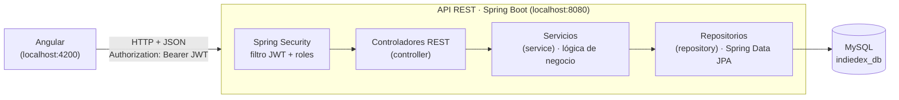
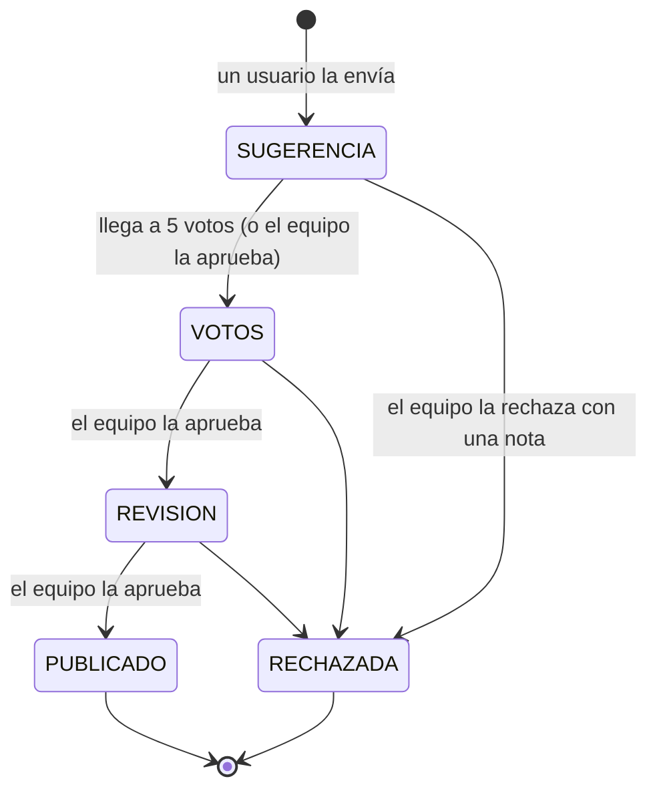

# IndieDex · La wiki de los juegos indie, en español

Proyecto de Back-End con **Spring Boot**: una wiki multijuego, solo de indies y en español.
Empieza con **Dredge** y crece con las propuestas y los votos de la comunidad.

**Integrantes:** Zoe Gabriel Balagay Aponte · Juandiego Rosas Reyes · Cristian Alexander Vargas Fajardo

---

## Tecnologías

| Capa | Tecnología |
|---|---|
| Backend | Java 17+, Spring Boot 3.5 (Web, Data JPA, Validation, Security), JWT (jjwt), Lombok |
| Base de datos | MySQL 8 |
| Documentación de la API | Swagger / OpenAPI (springdoc) |
| Frontend | Angular 21 |
| Pruebas de la API | Colección de Postman (62 peticiones con pruebas automáticas) |

## Arquitectura

Modelo cliente-servidor con el backend organizado por capas:



- **controller**: recibe la petición, valida los datos (`@Valid`) y responde con DTOs.
- **service**: reglas de la aplicación (flujo de sugerencias, un voto por usuario, permisos finos…).
- **repository**: consultas a la base de datos con Spring Data JPA.
- **model**: entidades JPA (las tablas).
- **dto**: lo que entra y sale de la API. **Nunca se devuelve la contraseña.**
- **exception**: un único formato de error para toda la API (`GlobalExceptionHandler`).

## Modelo de datos


El script completo está en [`database/schema.sql`](database/schema.sql).

### Flujo colaborativo de las sugerencias



El umbral de votos se cambia en `application.properties` (`indiedex.sugerencias.umbral-votos`).

---

## Cómo ejecutar el proyecto

### Requisitos

- **JDK 17 o superior** (funciona con 17, 21 y 24)
- **Maven 3.9+**, o abrir `backend/` en **IntelliJ IDEA** (trae Maven incluido)
- **MySQL 8** (sirve el de **XAMPP**)
- **Node.js 20.19+ o 22.12+** y npm (para Angular 21)

### 1. Base de datos

Enciende MySQL (en XAMPP: botón *Start* de MySQL). **No hace falta crear nada a mano**:
al arrancar, Spring crea la base `indiedex_db`, las tablas y los datos de ejemplo.

> Opcional: `mysql -u root -p < database/schema.sql` crea la base y las tablas con el script.

### 2. Backend (Spring Boot)

Si tu usuario `root` de MySQL **tiene contraseña** (en XAMPP por defecto no tiene):

1. Copia `backend/src/main/resources/application-local.properties.example`
   como `application-local.properties` en la misma carpeta.
2. Escribe ahí tu contraseña. Ese archivo **no se sube a GitHub**.

Luego, desde la carpeta `backend/`:

```bash
mvn spring-boot:run
```

O en IntelliJ: abrir la carpeta `backend`, esperar a que cargue Maven y ejecutar `IndiedexApplication`.

- API: <http://localhost:8080/api/juegos>
- **Swagger (documentación interactiva):** <http://localhost:8080/swagger-ui.html>

### 3. Frontend (Angular)

```bash
cd frontend
npm install
npm start
```

Abrir <http://localhost:4200>. La dirección del backend está en `frontend/src/app/core/api.config.ts`.

---

## Cuentas de prueba

Todas usan la contraseña **`indiedex123`**. Se puede entrar con el nombre o con el correo.

| Usuario | Correo | Rol | Puede |
|---|---|---|---|
| `admin` | admin@indiedex.com | ADMIN | Todo, incluido borrar juegos y cambiar roles |
| `FaroNorte` | faronorte@indiedex.com | EDITOR | Escribir artículos, revisar y publicar sugerencias |
| `MarineroLunar` | marinero@indiedex.com | EDITOR | Igual que FaroNorte |
| `LunaVerde` | lunaverde@correo.com | USER | Comentar, sugerir y votar |
| `NieblaBaja`, `SemillaAzul`, `Pescadora88` | … | USER | Comentar, sugerir y votar |

> Para probar el umbral de votos: "Abrir la wiki de Stardew Valley" tiene 4 votos.
> Regístrate con una cuenta nueva, vótala y pasará sola de *Sugerencia* a *Votos*.

## Permisos

| Acción | Sin sesión | USER | EDITOR | ADMIN |
|---|:-:|:-:|:-:|:-:|
| Ver juegos, artículos publicados, sugerencias | ✅ | ✅ | ✅ | ✅ |
| Comentar, sugerir, votar, editar mi perfil | | ✅ | ✅ | ✅ |
| Borrar mis comentarios | | ✅ | ✅ | ✅ |
| Crear/editar juegos, artículos, logros, objetos, personajes | | | ✅ | ✅ |
| Ver borradores, panel de revisión, aprobar/rechazar | | | ✅ | ✅ |
| Borrar comentarios de otros (moderar) | | | ✅ | ✅ |
| Borrar juegos, listar usuarios, cambiar roles | | | | ✅ |

## Rutas de la API

Todas empiezan por `http://localhost:8080`. La lista completa con ejemplos está en Swagger.

| Método | Ruta | Descripción |
|---|---|---|
| POST | `/api/auth/registro` | Crear cuenta (siempre USER) y devolver token |
| POST | `/api/auth/login` | Iniciar sesión con correo o usuario |
| GET | `/api/estadisticas` | Cifras del inicio |
| GET | `/api/buscar?q=` | Buscador global |
| GET | `/api/juegos?buscar=&genero=&estado=&orden=` | Catálogo con filtros |
| GET | `/api/juegos/{slug}` | Ficha del juego |
| GET | `/api/juegos/{slug}/articulos` · `/logros` · `/objetos` · `/personajes` | Pestañas de la wiki |
| POST · PUT · DELETE | `/api/juegos` · `/api/juegos/{id}` | Gestionar juegos |
| GET | `/api/articulos/recientes` · `/api/articulos/{id}` | Artículos |
| POST · PUT · PATCH · DELETE | `/api/articulos` · `/{id}` · `/{id}/estado` | Gestionar artículos |
| GET · POST · PUT · DELETE | `/api/logros` · `/api/objetos` · `/api/personajes` | Contenido de la wiki |
| GET · POST | `/api/articulos/{id}/comentarios` | Ver y escribir comentarios (con `padreId` para responder) |
| DELETE | `/api/comentarios/{id}` | Borrar comentario |
| GET · POST | `/api/sugerencias` | Listar (filtros, orden, búsqueda) y proponer |
| POST · DELETE | `/api/sugerencias/{id}/voto` | Votar y retirar voto |
| PATCH | `/api/sugerencias/{id}/avanzar` · `/rechazar` | Aprobar o rechazar con nota |
| GET | `/api/sugerencias/resumen` | Cifras del panel de revisión |
| GET · PUT | `/api/usuarios/me` | Mi perfil |
| GET | `/api/usuarios/me/sugerencias` · `/votos` · `/comentarios` | Mi actividad |
| GET · PATCH | `/api/usuarios` · `/api/usuarios/{id}/rol` | Administración de usuarios |

Los errores siempre tienen el mismo formato:

```json
{ "estado": 400, "error": "Bad Request", "mensaje": "Hay datos que corregir",
  "ruta": "/api/auth/registro", "fecha": "2026-10-20T15:30:00",
  "campos": { "email": "El correo no es válido" } }
```

## Pruebas con Postman

1. Importar `backend/postman/IndieDex.postman_collection.json`.
2. Con el backend encendido (y la base recién creada), abrir **Run collection** y ejecutarla en orden.
3. Cada petición guarda los datos que usan las siguientes (tokens, ids) y verifica la respuesta:
   permisos por rol (401/403), validaciones (400), duplicados (409), flujo de sugerencias y votos.

Para volver a los datos de ejemplo iniciales: borrar la base (`DROP DATABASE indiedex_db;`) y arrancar de nuevo.

## Estructura

```
IndieDex/
├── backend/
│   ├── pom.xml
│   ├── postman/                      Colección de pruebas
│   └── src/main/java/com/indiedex/
│       ├── config/                   Seguridad, Swagger y datos de ejemplo
│       ├── controller/               Controladores REST
│       ├── dto/                      Datos de entrada y salida
│       ├── exception/                Errores y manejador global
│       ├── model/                    Entidades JPA
│       ├── repository/               Repositorios Spring Data
│       ├── security/                 JWT y usuario autenticado
│       ├── service/                  Lógica de negocio
│       └── util/                     Utilidades (slugs, paginación)
├── database/
│   └── schema.sql                    Esquema de MySQL
└── frontend/
    ├── public/images/                Imágenes (la base de datos guarda solo su ruta)
    └── src/app/
        ├── core/                     Modelos, servicios HTTP, sesión, interceptor y guards
        ├── components/               Navbar, footer, anuncio, donación
        └── pages/                    Una carpeta por página
```

## Notas

- **Imágenes:** viven en `frontend/public/images/`. La base de datos guarda solo la ruta (`images/dredge.jpg`).
  Para un juego nuevo: copiar su imagen ahí y crear el juego con esa ruta.
- **Contenido de ejemplo:** la guía *Tu primera noche en el mar* es la que escribió el equipo en la maqueta.
  Las demás guías, logros, objetos y personajes de Dredge son textos de prueba: conviene revisarlos antes de presentar.
- **Configuración por variables de entorno** (opcional): `DB_HOST`, `DB_PORT`, `DB_NAME`, `DB_USER`, `DB_PASSWORD`,
  `JWT_SECRET`, `CORS_ORIGENES`, `UMBRAL_VOTOS`, `PORT`.
