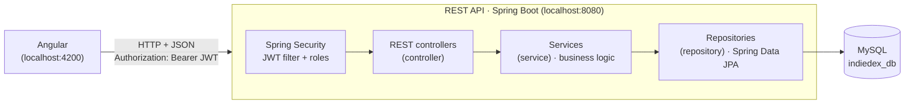
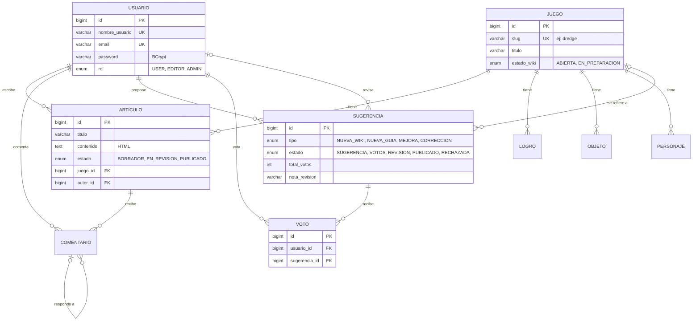
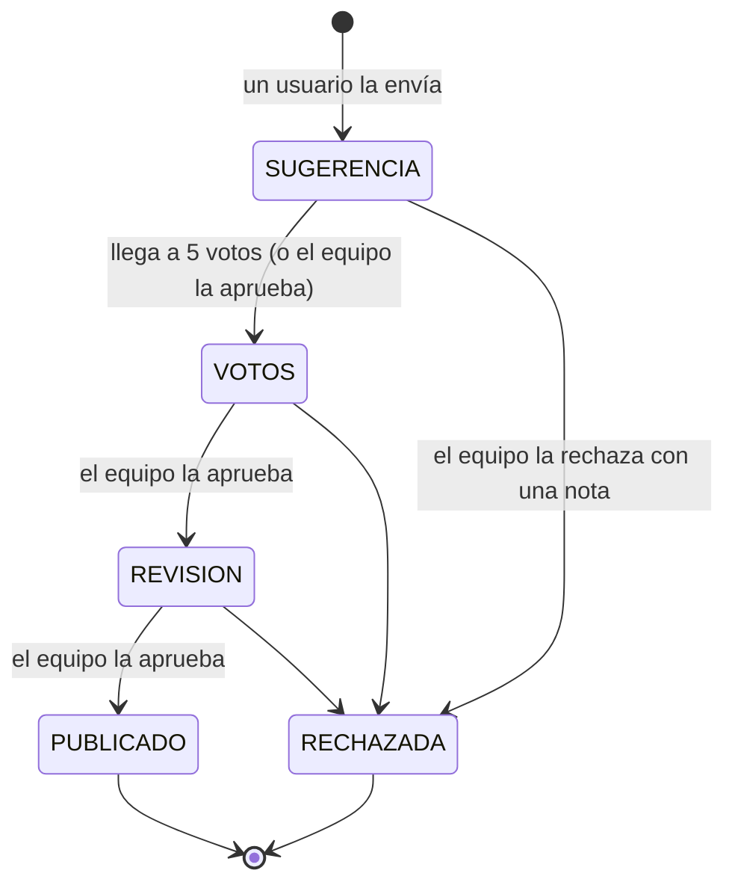

[English](README.md) | [Español](README.es.md)

# IndieDex

A multi-game wiki for indie titles, written entirely in Spanish. It opens with Dredge and grows from there: anyone can propose a new wiki or a new guide, and the proposals that collect enough community votes move on to review.

Back-End course project by Zoe Gabriel Balagay Aponte, Juandiego Rosas Reyes and Cristian Alexander Vargas Fajardo.

> Live site: add the Render URL here once the deploy finishes.

## Stack

The backend is Java 17+ with Spring Boot 3.5 (Web, Data JPA, Validation and Security), JWT handled by jjwt, and Lombok to cut down boilerplate. Data lives in MySQL 8. The API documents itself through Swagger/OpenAPI via springdoc, and the frontend is Angular 21. There is also a Postman collection with 62 requests that run their own assertions.

## Architecture

Client-server, with the backend split into layers:



A request lands on a controller, which validates the payload with `@Valid` and answers with DTOs. Controllers delegate to services, where the actual rules live: the suggestion workflow, one vote per user, the finer permission checks. Services talk to repositories, which are Spring Data JPA interfaces over the JPA entities in `model`. Everything that enters or leaves the API goes through a DTO, so the password hash never reaches the client. Errors are funneled through `GlobalExceptionHandler` so the whole API fails in one consistent shape.

## Data model



The full script is in [`database/schema.sql`](database/schema.sql).

### How a suggestion moves



Five votes is the default threshold, not a hard rule. Change `indiedex.sugerencias.umbral-votos` in `application.properties` if you want a different number.

## Running it locally

You need JDK 17 or newer (we tested on 17, 21 and 24), Maven 3.9+ or IntelliJ IDEA with its bundled Maven, MySQL 8 (the one shipped with XAMPP is fine), and Node.js 20.19+ or 22.12+ with npm for Angular 21.

### 1. Database

Start MySQL. In XAMPP that is the Start button next to MySQL. You don't need to create anything by hand: on boot, Spring creates the `indiedex_db` database, the tables and the sample data.

If you'd rather build the schema from the script, run `mysql -u root -p < database/schema.sql` first.

### 2. Backend

XAMPP ships with no password on `root`, so most people can skip this step. If yours does have one, copy `backend/src/main/resources/application-local.properties.example` to `application-local.properties` in the same folder and put your password there. That file is gitignored.

Then, from `backend/`:

```bash
mvn spring-boot:run
```

In IntelliJ, open the `backend` folder, wait for Maven to finish loading and run `IndiedexApplication`.

The API answers at <http://localhost:8080/api/juegos>, and Swagger is at <http://localhost:8080/swagger-ui.html>.

### 3. Frontend

```bash
cd frontend
npm install
npm start
```

Open <http://localhost:4200>. The backend address lives in `frontend/src/environments/`: `environment.development.ts` for local work, `environment.ts` for the deployed build.

## Deploying to Render

The app ships to [Render](https://render.com) as a single service. The `Dockerfile` builds Angular, drops it inside Spring Boot, and the page and the API end up on the same address. The database goes to TiDB Cloud (MySQL-compatible and free) because Render doesn't offer MySQL.

Full walkthrough in [DESPLIEGUE.md](DESPLIEGUE.md). The short version:

1. Create the free database on TiDB Cloud and copy the host, user and password.
2. On Render, go to New → Blueprint, pick this repository (it reads `render.yaml`) and fill in `DB_URL`, `DB_USER` and `DB_PASSWORD`.
3. Wait for the service to say Live, then open `https://tu-servicio.onrender.com`.

## JWT authentication

`POST /api/auth/login` (or `/registro`) checks the password against its BCrypt hash and hands back a JWT signed with HMAC-SHA, in `security/JwtService.java`. The token carries the username, the role and an expiry 24 hours out.

Angular stores it and attaches it to every request as `Authorization: Bearer <token>`, which happens in `frontend/src/app/core/auth.interceptor.ts`. On the way back in, `security/JwtAuthFilter.java` verifies the signature and the expiry and leaves the user authenticated; from there `config/SecurityConfig.java` and the `@PreAuthorize` annotations decide what that user is allowed to do.

No token, an expired one or a tampered one gets a 401. A valid token with an insufficient role gets a 403.

To see it running: log in from Swagger, copy the `token` from the response and paste it into Authorize.

## Test accounts

Every account uses the password `indiedex123`, and you can log in with either the username or the email.
On the deployed site, `admin` uses a different password set in Render (`ADMIN_PASSWORD`, see DESPLIEGUE.md).

| User | Email | Role | Can |
|---|---|---|---|
| `admin` | admin@indiedex.com | ADMIN | Everything, including deleting games and changing roles |
| `FaroNorte` | faronorte@indiedex.com | EDITOR | Write articles, review and publish suggestions |
| `MarineroLunar` | marinero@indiedex.com | EDITOR | Same as FaroNorte |
| `LunaVerde` | lunaverde@correo.com | USER | Comment, suggest and vote |
| `NieblaBaja`, `SemillaAzul`, `Pescadora88` | ... | USER | Comment, suggest and vote |

To watch the vote threshold fire, the suggestion "Abrir la wiki de Stardew Valley" sits at 4 votes. Register a fresh account, vote on it, and it jumps from Sugerencia to Votos on its own.

## Managing content as EDITOR or ADMIN

Logging in with a team account adds two links to the navbar, Gestión and Revisión.

Gestión → Juegos y contenido (`/equipo/juegos`) lists every game, and from there you can create and edit them. Deleting is ADMIN only, and it takes the whole wiki with it.

Nueva guía opens a form with a toolbar for inserting blocks (intro, subtitle, paragraph, tip, image, upgrade list, sources) and a preview that updates as you type. A guide saves as Borrador, En revisión or Publicado, and the first two are only visible to the team. Publishing a game's first guide flips its wiki to "Wiki abierta".

Achievements, items and characters each get a "+ Nuevo" button on their wiki tab and an "Editar" link on every card. Game and guide pages carry their own "Editar juego" and "Editar guía" buttons.

Revisión (`/revision`) is where community proposals get approved or rejected, with a note back to whoever wrote them.

Images are picked from whatever sits in `frontend/public/images`, listed in `core/imagenes.ts`.

## Permissions

| Action | Logged out | USER | EDITOR | ADMIN |
|---|:-:|:-:|:-:|:-:|
| View games, published articles, suggestions | yes | yes | yes | yes |
| Comment, suggest, vote, edit own profile | | yes | yes | yes |
| Delete own comments | | yes | yes | yes |
| Create/edit games, articles, achievements, items, characters | | | yes | yes |
| View drafts, review panel, approve/reject | | | yes | yes |
| Delete other people's comments (moderate) | | | yes | yes |
| Delete games, list users, change roles | | | | yes |

## API routes

Everything hangs off `http://localhost:8080`. Swagger has the full list with examples.

| Method | Route | What it does |
|---|---|---|
| POST | `/api/auth/registro` | Create an account (always USER) and return a token |
| POST | `/api/auth/login` | Log in with email or username |
| GET | `/api/estadisticas` | Numbers for the home page |
| GET | `/api/buscar?q=` | Global search |
| GET | `/api/juegos?buscar=&genero=&estado=&orden=` | Catalog with filters |
| GET | `/api/juegos/{slug}` | Game page |
| GET | `/api/juegos/{slug}/articulos` · `/logros` · `/objetos` · `/personajes` | Wiki tabs |
| POST · PUT · DELETE | `/api/juegos` · `/api/juegos/{id}` | Manage games |
| GET | `/api/articulos/recientes` · `/api/articulos/{id}` | Articles |
| POST · PUT · PATCH · DELETE | `/api/articulos` · `/{id}` · `/{id}/estado` | Manage articles |
| GET · POST · PUT · DELETE | `/api/logros` · `/api/objetos` · `/api/personajes` | Wiki content |
| GET · POST | `/api/articulos/{id}/comentarios` | Read and post comments (`padreId` to reply) |
| DELETE | `/api/comentarios/{id}` | Delete a comment |
| GET · POST | `/api/sugerencias` | List (filters, sorting, search) and propose |
| POST · DELETE | `/api/sugerencias/{id}/voto` | Vote and withdraw a vote |
| PATCH | `/api/sugerencias/{id}/avanzar` · `/rechazar` | Approve, or reject with a note |
| GET | `/api/sugerencias/resumen` | Numbers for the review panel |
| GET · PUT | `/api/usuarios/me` | My profile |
| GET | `/api/usuarios/me/sugerencias` · `/votos` · `/comentarios` | My activity |
| GET · PATCH | `/api/usuarios` · `/api/usuarios/{id}/rol` | User administration |

Errors always come back in the same shape:

```json
{ "estado": 400, "error": "Bad Request", "mensaje": "Hay datos que corregir",
  "ruta": "/api/auth/registro", "fecha": "2026-10-20T15:30:00",
  "campos": { "email": "El correo no es válido" } }
```

## Testing with Postman

Import `backend/postman/IndieDex.postman_collection.json`, start the backend on a freshly created database, then hit Run collection and let it go in order. Each request stashes what the next ones need (tokens, ids) and asserts on the response: role permissions (401/403), validation (400), duplicates (409), and the whole suggestion and voting flow.

To get back to the original sample data, drop the database (`DROP DATABASE indiedex_db;`) and start the app again.

## Project layout

```
IndieDex/
├── Dockerfile                        Deploy image (Angular + Spring Boot in one .jar)
├── render.yaml                       Render configuration
├── DESPLIEGUE.md                     Deployment guide
├── backend/
│   ├── pom.xml
│   ├── postman/                      Test collection
│   └── src/main/java/com/indiedex/
│       ├── config/                   Security, Swagger and sample data
│       ├── controller/               REST controllers
│       ├── dto/                      Request and response objects
│       ├── exception/                Errors and the global handler
│       ├── model/                    JPA entities
│       ├── repository/               Spring Data repositories
│       ├── security/                 JWT and the authenticated user
│       ├── service/                  Business logic
│       └── util/                     Helpers (slugs, pagination)
├── database/
│   └── schema.sql                    MySQL schema
└── frontend/
    ├── public/images/                Images (the database stores only the path)
    └── src/app/
        ├── core/                     Models, HTTP services, session, interceptor and guards
        ├── components/               Navbar, footer, announcement, donation
        └── pages/                    One folder per page
```

## Notes

The footer links to six informational pages: Sobre IndieDex, Normas, Contacto, Privacidad, Términos and Cookies. Their text lives in `frontend/src/app/core/textos.ts`, and the modals for the rules (on Sugerencias) and for the terms and privacy (on Registro) pull from that same file.

`/donar` is a demo page. It shows the thank-you message but never charges anything or asks for payment details.

Images sit in `frontend/public/images/` and the database only keeps the path, like `images/dredge.jpg`. To add a game, copy its image there and reference that path when you create it.

One caveat on the sample content: the guide "Tu primera noche en el mar" is the one the team actually wrote for the mockup. The rest of the Dredge guides, achievements, items and characters are placeholder text, so give them a read before presenting.

The app can also be configured through environment variables, which is optional locally but how the Render deploy works: `DB_HOST`, `DB_PORT`, `DB_NAME`, `DB_USER`, `DB_PASSWORD`, `JWT_SECRET`, `CORS_ORIGENES`, `UMBRAL_VOTOS` and `PORT`.
